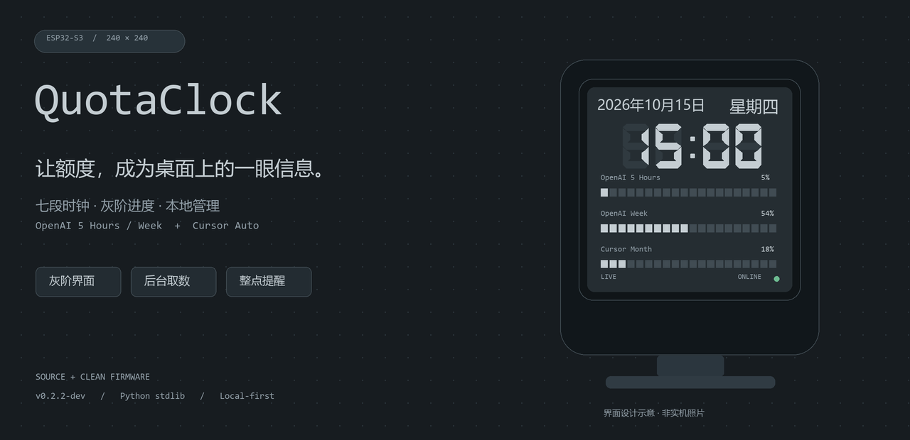
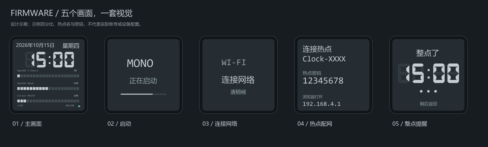
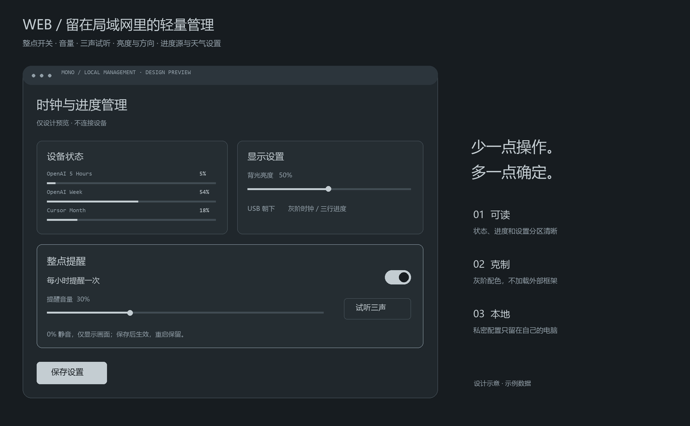
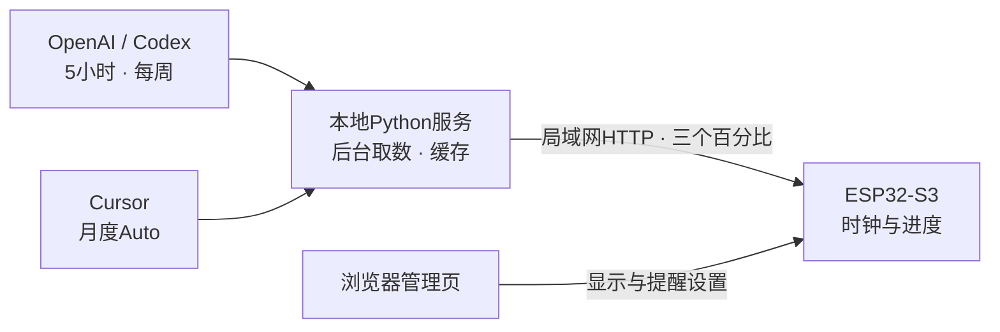

<p align="center">
  
</p>

<h1 align="center">余刻 · QuotaClock</h1>
<p align="center"><strong>时间一眼可见，额度心中有数。</strong></p>
<p align="center">一块240×240的小屏幕，把时钟、AI额度和整点提醒留在桌面上，兼容并保留V1.4天气时钟功能。</p>
<p align="center"><code>ESP32-S3</code> · <code>v0.2.2-dev</code> · <code>Local-first</code> · <code>Python stdlib</code></p>
<p align="center">
  <a href="#界面一览">界面一览</a> ·
  <a href="#快速开始">快速开始</a> ·
  <a href="docs/DEVELOPMENT.md">开发说明</a> ·
  <a href="docs/RUNNING.md">运行与迁移</a> ·
  <a href="rom/README.md">固件成品</a>
</p>

> 图中均为**设计示意和示例数据，非实机照片**，不含真实账号、热点密码或网络配置。项目基于SDD V1.4增量开发；公开发布前请先阅读 [第三方来源与授权注意](THIRD_PARTY.md)。

## 小屏幕，刚刚好

不必反复切回用量页面。QuotaClock通过本地Python服务获取自己的账号额度，再把三个**已使用百分比**显示在桌面屏幕上；保留V1.4天气时钟作为可选界面，MONO是其灰阶界面风格。

| 一眼看清 | 随手管理 |
| :--- | :--- |
| **七段时钟** · 完整年月日与星期，克制的灰阶配色 | **局域网管理** · 调亮度、方向、进度源和天气参数 |
| **三行额度** · OpenAI 5小时 / 每周、Cursor月度Auto | **整点提醒** · 独立开关、音量、三声试听 |
| **状态明确** · DEMO / SIM / LIVE，异常保留上次有效值 | **轻量服务** · 标准库实现，后台运行，独立虚拟环境 |

## 界面一览

### 固件 · 从开机到整点，保持同一种安静



主画面保留七段数字和紧凑的分段进度条；启动、连接和配网页只留下必要信息。开启整点提醒后，到点切换提醒页、嘟三声，再返回原进度页或天气页。

- **默认关闭提醒**，音量默认30%；0%仅显示提醒画面。
- 提醒开关和音量保存后生效，重启保留；试听不需要保存。
- 未校时、启动或配网期间不提醒，不补报过去的整点。

**打开交互设计稿：** [固件屏幕预览](clock_rom/hourly_firmware_preview.html)

### WEB · 用浏览器管理，不为小屏幕增加按键



状态、显示、整点提醒、进度服务与天气设置分区呈现。管理页面内嵌CSS/JS，不加载外部框架、字体或图片。

**打开交互设计稿：** [完整WEB管理预览](clock_rom/hourly_web_preview.html)

<sub>下载或克隆后，在本机浏览器打开两个HTML入口。GitHub中的HTML链接通常展示源码，不会直接运行预览；浏览器试听也不代表设备喇叭的实际响度。</sub>

## 数据怎么来到屏幕上



| 屏幕行 | 数据口径 |
| :--- | :--- |
| `OpenAI 5 Hours` | Codex 5小时窗口已使用比例 |
| `OpenAI Week` | Codex每周窗口已使用比例 |
| `Cursor Month` | `autoPercentUsed`，月度Auto额度池已使用比例 |

**Token留在电脑上，屏幕只接收百分比。** 服务启动即后台取数，成功后每5分钟刷新；设备默认每5分钟请求。请求直接读缓存，不等待外部接口。失败返回503，设备保留旧值，不把异常伪装成0%。

> 额度来自非公开仪表盘接口，可能随上游变更而失效。Token需要手动更新；只访问自己有权限的账号，不提供跨账号抓取或自动轮换其他应用凭据的功能。

## 快速开始

### 1 · 先确认硬件

目标配置为 **ESP32-S3 / 8MB flash / 8MB OPI PSRAM / ST7789 240×240**，音频为ES8311＋NS4150B。它不是适配所有ESP32-S3板卡的通用固件。

已有对应固件的设备可直接配置服务；需要刷写时，先核对接线、安全状态并双读备份，阅读 [ROM与设备安全](rom/README.md)。**不要把“有成品BIN”理解成可以直接盲刷。**

### 2 · 在电脑启动服务

Windows安装Python 3.9+后，双击：

```text
progress_service/start.cmd     启动 / 安全重启，后台无窗口
progress_service/stop.cmd      关闭本目录服务
```

首次启动自动创建 `.venv` 和空的 `config.private.json`，按提示在本机填写凭据后再次启动。

| 配置字段 | 填写内容 |
| :--- | :--- |
| `openai.access_token` | 有效的Codex登录访问令牌，不是 `sk-` API Key |
| `openai.account_id` | 与访问令牌对应的账号ID |
| `cursor.session_token` | `WorkosCursorSessionToken` Cookie的原始值 |

私密文件已被 `.gitignore` 排除，**不要提交或截图分享**。详细说明见 [运行与迁移](docs/RUNNING.md)。

### 3 · 让屏幕连接到服务

连接设备Wi-Fi，在设备管理页填写：

```text
http://电脑局域网IP:8766/api/progress
```

不是 `localhost`。保存后先拉取一次，再按周期更新；底部 `LIVE` 表示真实来源，`SIM` 是服务端测试数据，`DEMO` 是设备本地演示。

<details>
<summary><strong>设备亮红灯，先检查什么？</strong></summary>

- 电脑服务是否仍运行：访问 `/health`；它只证明进程健康，不代表上游账号认证成功。
- `/api/progress` 是否返回200与 `simulation:false`。
- 电脑和设备是否互通、IP是否改变、防火墙是否允许；项目不会自动改防火墙。
- Token是否过期。请求失败时旧值会保留，因此“仍有数字”不代表更新正常。

</details>

## 想继续开发

依赖版本与目标参数记录在 `ARCHIVE_INFO.json`；配套库源码和板卡配置已包含，不需要提交整个工具链。

```powershell
# 安装构建脚本所用的Python工具
py -3 -m pip install esptool==5.5.0

# 安装隔离Arduino-ESP32 2.0.12，不改全局Arduino core
powershell -NoProfile -ExecutionPolicy Bypass -File .\maintenance\restore_dev.ps1 -InstallCore

# 仅编译和校验，不上传
powershell -NoProfile -ExecutionPolicy Bypass -File .\clock_rom\build.ps1
```

完整前置条件和测试命令见 [开发说明](docs/DEVELOPMENT.md)。新构建使用独立时间戳目录，校验S3、8MB边界与固定分区布局；重新编译可能因路径/时间戳改变ROM哈希。

### 先设计，再落地

```text
WEB与固件分别预览 → 反馈并确认 → 修改代码 → 编译测试
                                               ↓
实机确认 ← 校验部署 ← 当次刷机授权 + 新双读备份
```

当前0.2.2已在原设备完成写入、独立校验和8MB全片复读。整点音效、完整天气与不同板卡仍需分别验证，不能用写入成功代替全部功能确认。

## 目录导航

```text
.
├─ clock_rom/                  固件、管理页、两个独立设计预览
├─ progress_service/           额度适配、启动/关闭、配置模板与测试
├─ maintenance/restore_dev.ps1  隔离工具链恢复入口
├─ vendor/clock_rom/libraries/  锁定的配套库源码与配置
├─ rom/                        干净ROM、SHA256与刷写边界
├─ docs/                       开发/运行说明、README本地配图
├─ ARCHIVE_INFO.json           依赖版本、目标参数
├─ SUBMISSION_MANIFEST.json    本提交目录逐文件校验
└─ THIRD_PARTY.md              第三方来源与发布前授权检查
```

## 安全与授权

- **只用于可信局域网。** 管理页免登录，服务也无公网认证机制，不要端口转发到互联网。
- 本目录不含真实Token、Wi-Fi配置、账号/设备身份记录、实机NVS镜像、备份、运行日志或虚拟环境；成品ROM的NVS已检查为空。
- 仅提交本目录，不提交上级工作区或旧 `archives/`。不要把Codex/OpenCode的登录文件复制进来。
- 保留原厂备份与恢复链路；禁止强行16MB布局、烧写eFuse或绕过安全检查。
- **发布前核实第三方许可。** 基于SDD V1.4，保留原作者署名；字库、图片与生成字形的授权需核实。未擅自为全工程添加MIT/Apache许可证，详见 [THIRD_PARTY.md](THIRD_PARTY.md)。

---

<p align="center"><sub>余刻 QuotaClock · 一眼时间，一眼额度。</sub></p>
